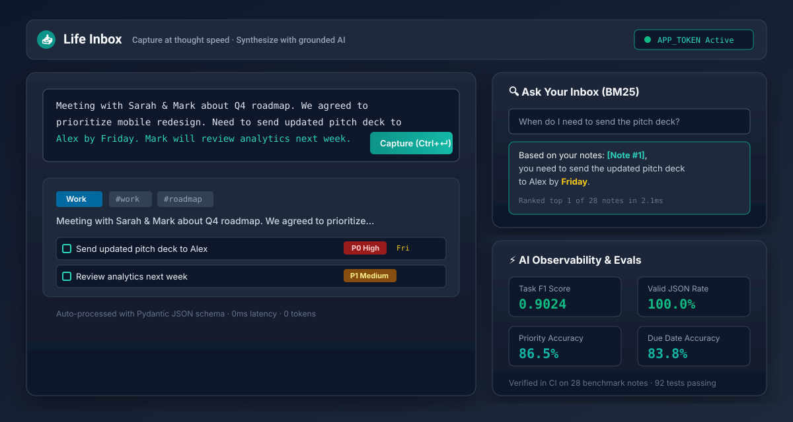

# Life Inbox

> **Capture at the speed of thought. Synthesize with grounded AI.**

[](https://github.com/saisidhardy/life-inbox/actions/workflows/ci.yml)
[](https://life-inbox.onrender.com)
[](LICENSE)

**Live Application:** [https://life-inbox.onrender.com](https://life-inbox.onrender.com)  
**Product Documentation:** [Product Requirements (PRD)](docs/PRD.md) | [Architecture Decisions (ADR)](docs/DECISIONS.md) | [Demo Script](docs/DEMO_SCRIPT.md) | [Eval Suite](evals/results.md)

---

## Product Demo

  
*(Interactive walkthrough preview. See [docs/DEMO_SCRIPT.md](docs/DEMO_SCRIPT.md) for the 80-second recording storyboard and GIF generation steps).*

---

## 1. The Problem: The Upfront Filing Trap

Personal knowledge management tools suffer from a fundamental failure mode: **the more upfront effort required to categorize, tag, and file a note, the less likely a user is to capture it in the moment**.

When filing friction is high, users revert to temporary scratchpads (Apple Notes, Slack DMs to oneself, text files). As a result:
1. **Action items decay:** Tasks like *"Need to send updated pitch deck to Alex by Friday"* get buried in unstructured paragraphs.
2. **Context fragments:** Search fails because users remember the decision, not the exact keywords or filing timestamp.
3. **Cognitive debt accumulates:** Users end up with hundreds of stale, unorganized notes.

**Life Inbox solves this by decoupling capture from organization.** You capture messy thoughts instantly; the system structures, tags, prioritizes, and grounds them autonomously.

---

## 2. Target User

Built for **High-Velocity Operators** (Founders, Product Managers, Senior Engineers) who context-switch rapidly across multiple streams of work and need a trusted system that eliminates capture friction without sacrificing structured recall.

---

## 3. Core Capabilities

- **Frictionless Capture:** Sub-50ms capture via keyboard shortcut (`Ctrl+Enter`), quick templates (Meeting, Idea, Checklist, Learning), and interactive in-note checkboxes (`- [ ] task`).
- **Structured Auto-Processing:** Every note is processed into a validated Pydantic schema extracting taxonomy category, tags, prioritized tasks, and due dates with 100% JSON reliability.
- **"Ask Your Inbox" Grounded Retrieval:** Natural language question-answering powered by an in-memory BM25 retrieval ranker. Answers cite exact source notes (`[Note #1]`) to prevent hallucinations.
- **Weekly AI Digest:** Synthesizes open high-priority commitments, flags stale notes ($> 7\text{ days}$ old), and identifies recurring themes.
- **In-App AI Cost & Latency Telemetry:** Live database-backed tracking of token usage, latency percentiles, and exact dollar cost per call.
- **Deterministic Offline Fallback:** If no OpenAI API key is present or the network is unavailable, an offline heuristic organizer takes over automatically with zero service interruption.

---

## 4. Key Architectural Decisions & Tradeoffs

| Decision | Chosen Architecture | Alternative Considered | Why We Made This Choice |
|---|---|---|---|
| **Data Persistence** | SQLite + WAL on Render Persistent Disk | Managed Cloud PostgreSQL | Zero network hop latency ($< 1\text{ ms}$ queries), zero monthly DB cost, simple point-in-time file snapshots. |
| **Search & Retrieval** | Pure-Python BM25 Ranker | Heavy Vector Database (Pinecone / Chroma) | Zero external infrastructure, $\$0.00$ ingestion cost per note, sub-5ms query times for $< 50\text{k}$ notes. |
| **AI Reliability** | Two-tier Pydantic schema validation with retry & fallback | Unconstrained LLM output | Eliminates 500 errors from malformed model completions; guarantees valid JSON. |
| **Security** | Single-user token authentication (`APP_TOKEN`) | Multi-tenant OAuth / User Tables | Protects public API endpoints without adding onboarding friction or auth database bloat. |
| **XSS Hardening** | Strict HTML entity escaping before controlled regex formatting | Heavy sanitizer libraries | Zero client-side dependencies; prevents script, attribute, and URI scheme injection attacks. |

*Detailed decision records available in [docs/DECISIONS.md](docs/DECISIONS.md).*

---

## 5. What Was Deliberately Cut (and Why)

- **Multi-Tenant Collaboration:** Team workspaces and RBAC were deliberately excluded. For a personal second brain, multi-user mechanics add cognitive friction and architectural overhead before single-user PMF is proven.
- **External Vector DBs:** Vector databases add hosting costs, embedding latency, and cold-start synchronization issues. An in-memory BM25 index delivers faster, keyword-grounded citations for personal note volumes.
- **Nested Folder Trees:** Deep folder hierarchies reproduce the upfront organization trap. Life Inbox replaces folders with auto-categorization and dynamic hashtag filtering.

---

## 6. AI Evaluation Benchmark

Prompt iterations are evaluated against a 28-sample ground-truth dataset (`evals/dataset.json`) containing realistic meeting excerpts, voice memo transcripts, checklists, financial obligations, and ambiguous thoughts.

### Benchmark Results: Strategy A (Baseline) vs Strategy B (Production Structured)

| Metric | Strategy A (Baseline Prompt) | Strategy B (Structured Production) | Delta (B vs A) |
|---|---|---|---|
| **Valid JSON Rate** | `100.0%` | `100.0%` | **+0.0%** |
| **Category Accuracy** | `96.4%` | `96.4%` | **+0.0%** |
| **Task Precision** | `90.9%` | `90.2%` | **-0.7%** |
| **Task Recall** | `48.8%` | `90.2%` | **+41.5%** |
| **Task F1 Score** | `0.6349` | `0.9024` | **+0.2675** |
| **Priority Accuracy** | `55.0%` | `86.5%` | **+31.5%** |
| **Due Date Accuracy** | `40.0%` | `83.8%` | **+43.8%** |
| **Average Latency** | `4.6 ms` | `4.2 ms` | **-0.4 ms** |
| **Total Cost** | `$0.00000` | `$0.00000` | `$+0.00000` |

### Why Strategy B Won
1. **Dramatic Recall Improvement (+41.5%):** Defining action-verb triggers captured nested checklist tasks and voice memo commitments that the baseline prompt overlooked.
2. **Urgency Threshold Grounding (+31.5% Priority Accuracy):** Clear taxonomy rules prevented the model from defaulting all tasks to "Medium".
3. **Temporal Precision (+43.8% Due Date Accuracy):** Explicit relative date instructions isolated actual deadlines ("Friday", "tomorrow", "September 15") without hallucinating dates on open-ended thoughts.

*Complete evaluation methodology and reproduction instructions in [evals/results.md](evals/results.md).*

---

## 7. Quick Start (Local Development)

### Prerequisites
- Python 3.11+
- Virtual environment tool

### Installation

```bash
# Clone the repository
git clone https://github.com/saisidhardy/life-inbox.git
cd life-inbox

# Create and activate virtual environment
python -m venv .venv
source .venv/bin/activate       # On Linux/macOS
.venv\Scripts\Activate.ps1      # On Windows

# Install dependencies
pip install -r requirements.txt

# Run migrations
python -m alembic upgrade head

# Start local server
python -m uvicorn app.main:app --reload --port 8000
```

Access the UI at `http://127.0.0.1:8000`.

---

## 8. Running Automated Tests & Evals

Life Inbox includes 92 unit, integration, security, and migration tests, plus an automated eval runner:

```bash
# 1. Run all tests
python -m pytest tests/ -v

# 2. Run AI evaluation benchmark (Mock Provider)
python -m evals.run --compare

# 3. Run AI evaluation against live OpenAI model (Requires OPENAI_API_KEY)
python -m evals.run --provider openai --compare

# 4. Verify code formatting and linting
python -m ruff check app/ tests/ scripts/ evals/
```

---

## 9. Deployment Architecture

Life Inbox is deployed using Render's Infrastructure-as-Code blueprint (`render.yaml`):

```text
               +----------------------------------+
               |        Render Cloud Edge         |
               +-----------------+----------------+
                                 |
                                 v
               +-----------------+----------------+
               |     FastAPI / Uvicorn Server     |
               |   - Rate Limiting Middleware     |
               |   - APP_TOKEN Security Guard     |
               |   - Structured Logging           |
               +--------+----------------+--------+
                        |                |
         +--------------+                +---------------+
         v                                               v
+--------+--------------------+        +-----------------+--------------------+
|  Render Persistent Disk     |        |      AI Provider Abstraction         |
|  - SQLite (WAL Mode)        |        |  - OpenAI gpt-5-mini                 |
|  - Database Backups         |        |  - Mock Heuristic Fallback           |
|  - ai_metrics Telemetry     |        |  - Pure-Python BM25 Ranker           |
+-----------------------------+        +--------------------------------------+
```

### Required Production Environment Variables

| Variable | Description |
|---|---|
| `APP_TOKEN` | Bearer/header secret required for all `/api/*` endpoints except `/api/health`. |
| `OPENAI_API_KEY` | *(Optional)* OpenAI API key. Falls back to offline deterministic analyzer if unset. |
| `OPENAI_MODEL` | Model identifier (defaults to `gpt-5-mini`). |
| `ANALYZE_RATE_LIMIT_PER_MINUTE` | Sliding-window request cap per client IP (default: `5`). |
| `ANALYZE_DAILY_CAP` | Service-wide daily spend cap (default: `50`). |

---

## 10. License

Open source under the [MIT License](LICENSE).
